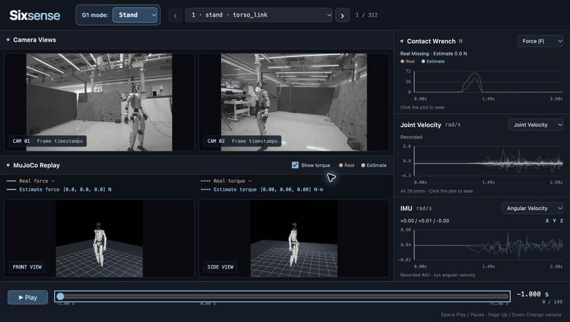
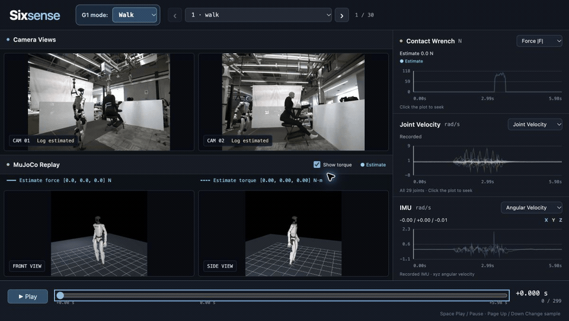
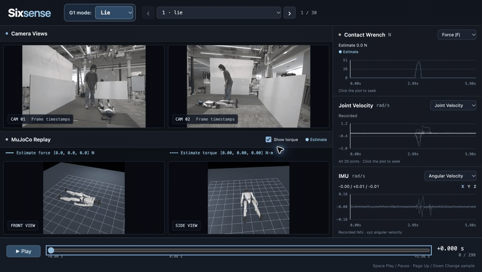
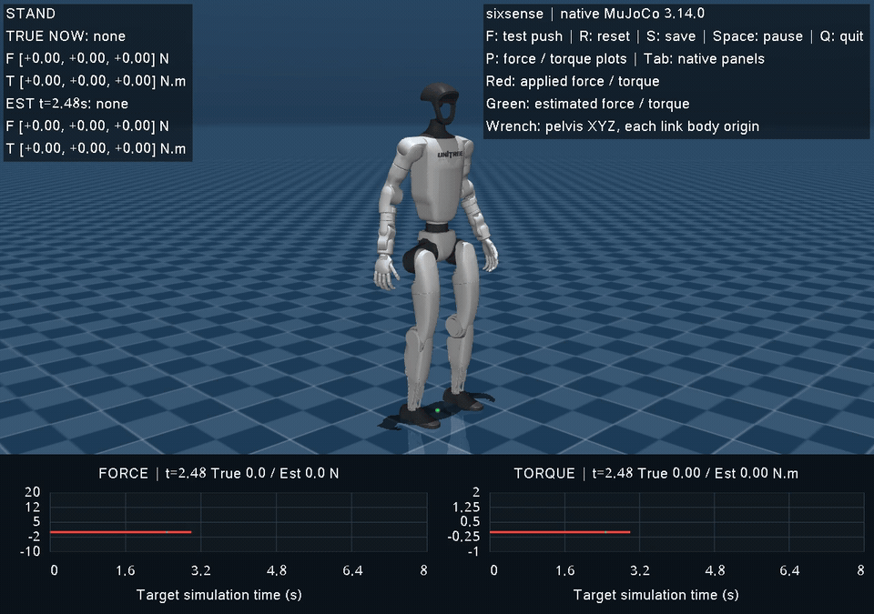
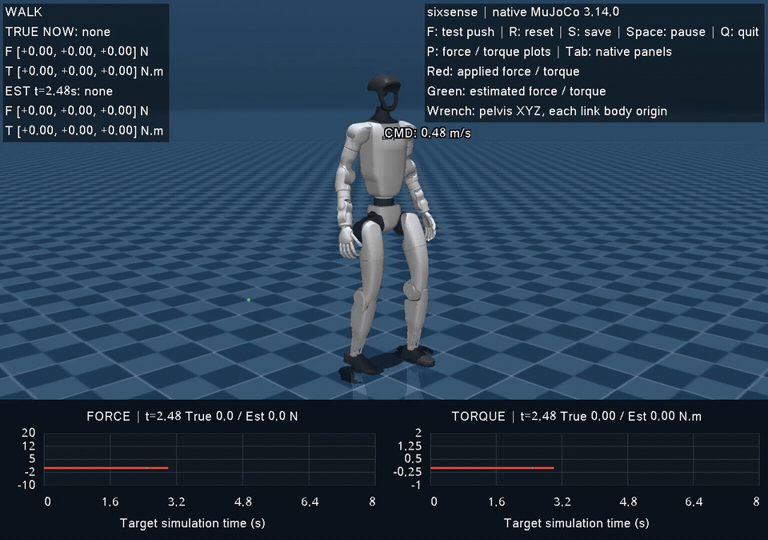
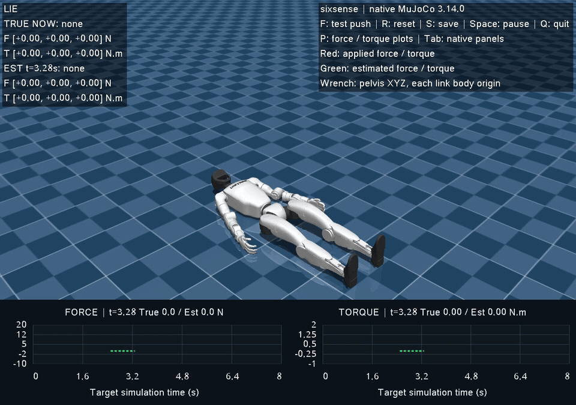
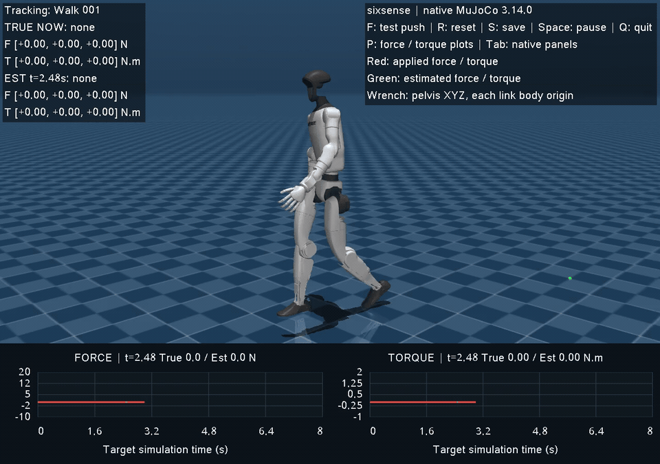
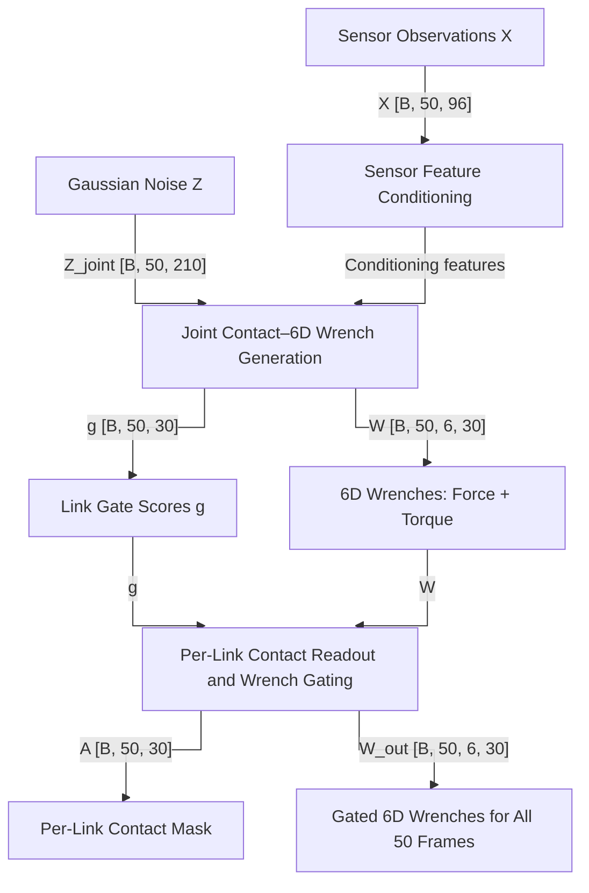

# SixthSense

**SixthSense estimates whole-body contact timing, location, and 6D wrenches from proprioceptive and IMU signals using conditional flow matching.** This repository includes an ONNX model, recorded robot data, a browser replay viewer, and MuJoCo simulation for standing, walking, lying, and TWIST2 motion tracking.

## Paper

**SixthSense: Task-Agnostic Proprioception-Only Whole-Body Wrench Estimation for Humanoids** has been accepted for publication in **IEEE Robotics and Automation Letters (RA-L)**. SixthSense enables whole-body contact perception for humanoids using proprioception alone, without tactile or force sensors. We release a **21.6-minute real-world contact dataset collected on the Unitree G1 humanoid robot**, with 372 recordings across standing, walking, and lying, including robot signals and paired camera videos.

[arXiv](https://arxiv.org/abs/2605.01427) · [Hugging Face](https://huggingface.co/datasets/BlablaO/SixthSense-G1-Contact-Dataset)

## 1. Installation

Install Python 3.13, then run from the project directory:

```sh
python -m pip install -r requirements.txt
```

## 2. Recorded Robot Replay

This repository includes a compact dataset subset with 43 recordings across standing, walking, and lying, including HDF5 signals and paired camera videos.

The **[complete SixthSense G1 Contact Dataset is available on Hugging Face](https://huggingface.co/datasets/BlablaO/SixthSense-G1-Contact-Dataset)**. It contains **372 recordings** (312 standing, 30 walking, and 30 lying), with robot signals, paired camera videos, and scenario-specific contact annotations. See the dataset card for the file structure, signal fields, and annotation details.

### 2.1 Standing

```sh
python sixthsense.py real stand
```




### 2.2 Walking

```sh
python sixthsense.py real walk
```




### 2.3 Lying

```sh
python sixthsense.py real lie
```




## 3. Simulation

The GIFs show selected simulation rollouts using the native MuJoCo UI. Red curves show true force and torque; green curves show estimates aligned to the same target timestamps.

### 3.1 Standing

```sh
python sixthsense.py sim stand
```



### 3.2 Walking

```sh
python sixthsense.py sim walk
```



### 3.3 Lying

```sh
python sixthsense.py sim lie
```



### 3.4 TWIST2 Motion Tracking

```sh
python sixthsense.py sim tracking --motion 1 --single-motion
```




## 4. Network Architecture

The diagram summarizes the main generation and readout path. The model jointly generates contact gate scores and a **6D wrench** `[Fx, Fy, Fz, Tx, Ty, Tz]` for each of 30 body links at every frame.



`B` is the batch size; `50` is the number of frames; `30` is the number of target links; `6` denotes three force and three torque components.

| Variable | Meaning |
|---|---|
| `X` | Robot signals: 9 IMU features and position, velocity and motor torque for each of 29 joints. |
| `Z_joint` | Random noise: 7 channels per link, 210 in total. |
| `C` | Features extracted from the robot signals. |
| `g`, `W` | Contact gate scores and 6D wrenches for each link. |
| `A`, `W_out` | Contact mask and final wrenches: `W_out = A * W`. Inactive links have zero force and torque. |

The ONNX outputs `raw_wrench` (`W`) and `wrench` (`W_out`) both have shape `[B, 50, 6, 30]`: 50 frames, 6 components and 30 links per sample. Components are `[Fx, Fy, Fz, Tx, Ty, Tz]`, with force in N and torque in N·m. Both use pelvis axes; torque is measured about each link's body origin.

## 5. Citation

If you use this code or the dataset, please cite:

```bibtex
@article{chen2026sixthsense,
  title   = {SixthSense: Task-Agnostic Proprioception-Only Whole-Body Wrench Estimation for Humanoids},
  author  = {Chen, Xingzhou and Xu, Xiayan and Ning, Yan and Yu, Jiyu and Zhang, Yizheng and Qian, Siyi and Xiang, Lingzhu and Chen, Jiahao and Wang, Yuquan and Zhang, Haodong and Shi, Ling},
  journal = {arXiv preprint arXiv:2605.01427},
  year    = {2026},
  doi     = {10.48550/arXiv.2605.01427},
  url     = {https://arxiv.org/abs/2605.01427},
  note    = {Accepted for publication in IEEE Robotics and Automation Letters (RA-L)}
}
```
